# Marché immobilier de la Côte d'Azur : où et quand acheter ?


Analyse de **toutes les ventes immobilières des Alpes-Maritimes** depuis 2021, à partir des données notariales ouvertes (DVF). Du fichier brut à un tableau de bord **Power BI** interactif, avec un pipeline SQL testé, des contrôles qualité automatiques, un modèle statistique des prix et une note de synthèse PDF. Le tout se met à jour seul chaque mois.

**[Tableau de bord Power BI](#le-tableau-de-bord-power-bi)** · **[Note de synthèse (PDF)](outputs/note_de_synthese.pdf)** · [Méthodologie](docs/methodologie.md)

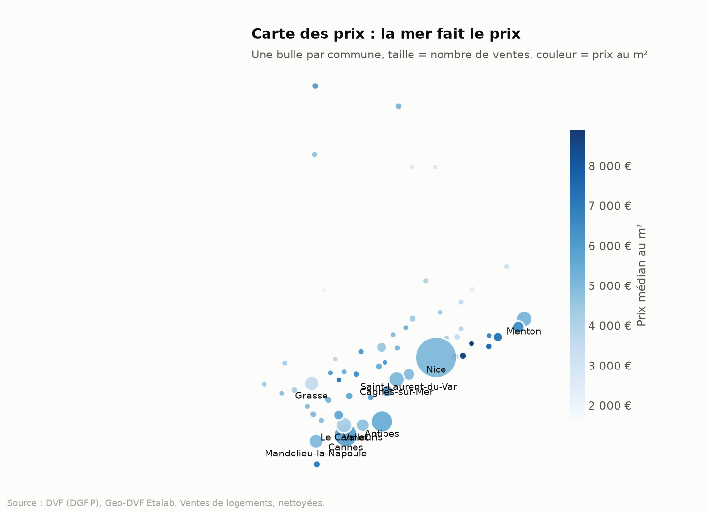

---

## La question métier

> *Pour un acheteur ou un investisseur : quelles communes offrent le meilleur rapport prix/emplacement, comment le marché a-t-il réagi à la hausse des taux de 2023, et que peut-on acheter avec un budget donné ?*

## Principaux enseignements

<!-- FINDINGS:START -->
1. **Prix contre volumes.** Entre 2021 et 2025, le nombre de ventes a évolué de -15,2 % et le prix médian au m² de +14,3 %. En clair, le marché s'est ajusté par les **volumes**, pas par les prix : les vendeurs ont préféré attendre plutôt que baisser.
2. **Le pic est passé.** Le pic d'activité date de 2022 avec 29 083 ventes. En 2025, on en compte 23 289, soit -19,9 % par rapport au pic.
3. **Un département, deux marchés.** En 2025, Èze est la commune la plus chère (8 906 €/m²) et Gréolières la plus accessible (2 093 €/m²), un écart de x4,3 (communes avec au moins 30 ventes).
4. **Commune à surveiller.** Parmi les communes avec au moins 60 ventes, Valbonne affiche la plus forte hausse sur un an (+11,0 %, à 5 509 €/m²).
5. **Le prix de la mer.** Un appartement sur une commune littorale se vend +27,9 % plus cher au m² que dans l'arrière-pays (5 061 € contre 3 958 €).
6. **Les studios, chers au m².** Un T1 se négocie 5 265 €/m² contre 4 402 €/m² pour un T4 (+19,6 %). La demande locative et saisonnière tire les petites surfaces.
7. **Ce que permet un budget de 300 000 €.** Au prix médian, 300 000 € achètent environ 113 m² à Sospel mais seulement 35 m² à Beaulieu-sur-Mer.
8. **Saisonnalité.** Les mois les plus actifs sont juin, juil., sept. ; août est le plus calme (6,7 % des ventes annuelles contre 9,8 % pour juin).
9. **Qualité des données.** 184 548 mutations brutes, 124 231 ventes de logements conservées (67,3 %). Premier motif d'exclusion : « aucun logement » (20,0 %).
10. **À caractéristiques égales.** Le modèle de prix (R² = 27,7 %, 124 148 ventes) isole chaque facteur : un T1 vaut +12,2 % au m² par rapport à un T3 de la même commune, la même année, et une maison +44,5 % par rapport à un appartement(terrain compris).
11. **Le prix brut peut tromper.** À Opio, la médiane brute surestime le niveau de prix de 39,4 points (indice 142,2 brut contre 102,8 à caractéristiques égales, Nice = 100) : c'est le type de biens vendus qui joue, pas la commune elle-même.

_Généré automatiquement le 04/11/2026 par `make run`._
<!-- FINDINGS:END -->

## Le tableau de bord Power BI

| Vue d'ensemble | Simulateur de budget |
|---|---|
| 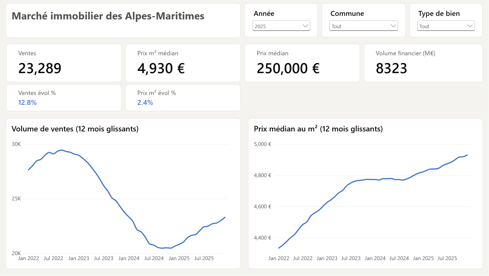 | 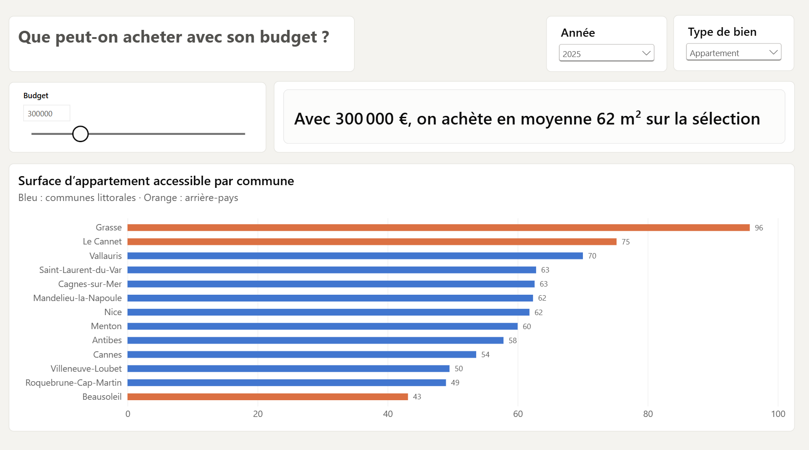 |

- **Vue d'ensemble** : ventes, prix médian au m², prix médian et volume financier, comparés automatiquement à l'année précédente (bleu si hausse, orange si baisse). Tendances sur 12 mois glissants pour lisser la saisonnalité.
- **Simulateur de budget** : un curseur de 100 000 à 1 M€ calcule la surface d'appartement accessible dans les plus grands marchés du département. Les communes littorales en bleu, l'arrière-pays en orange.
- **Modèle** : schéma en étoile importé en Parquet, table de dates marquée, 23 mesures DAX (`SAMEPERIODLASTYEAR`, `DATESINPERIOD`, `RANKX`, paramètre What-if, titres et couleurs dynamiques). Médiane publiée seulement à partir de 30 ventes.

Fichier : [`powerbi/dvf_cote_azur.pbix`](powerbi/dvf_cote_azur.pbix) · mesures : [`powerbi/mesures.dax`](powerbi/mesures.dax)

## Analyses

| | |
|---|---|
| 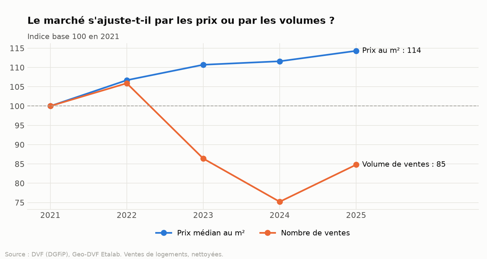 | 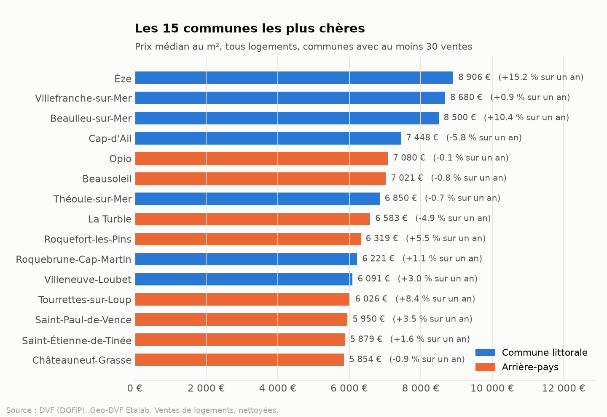 |
| 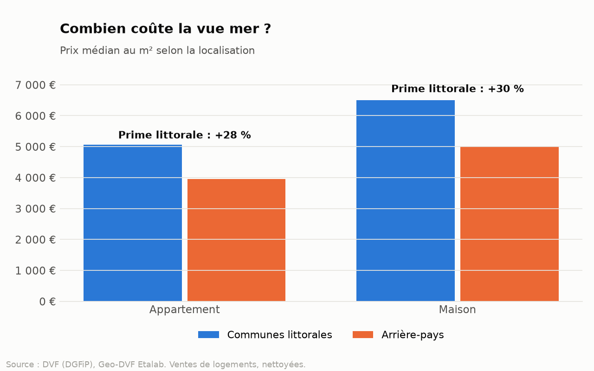 | 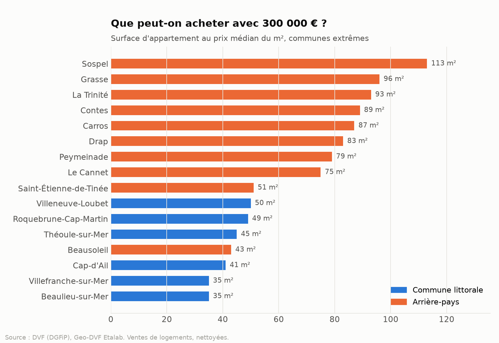 |
| 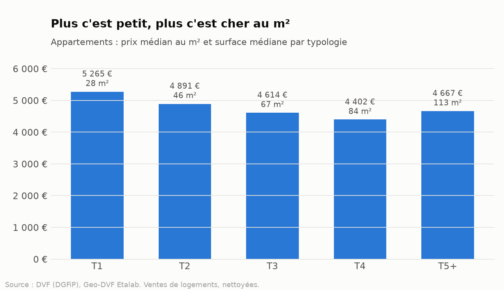 | 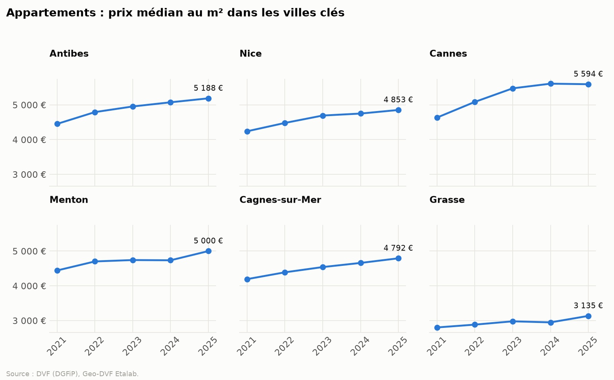 |

## Ce qui fait le prix : un modèle statistique

Comparer des médianes mélange deux choses : la commune, et ce qui s'y vend. Une commune qui vend surtout des studios paraît chère au m² sans l'être. Un **modèle de régression hédonique** (OLS sur le log du prix au m², erreurs robustes) sépare les effets : commune, type de bien, typologie, année, dépendance.

| | |
|---|---|
| 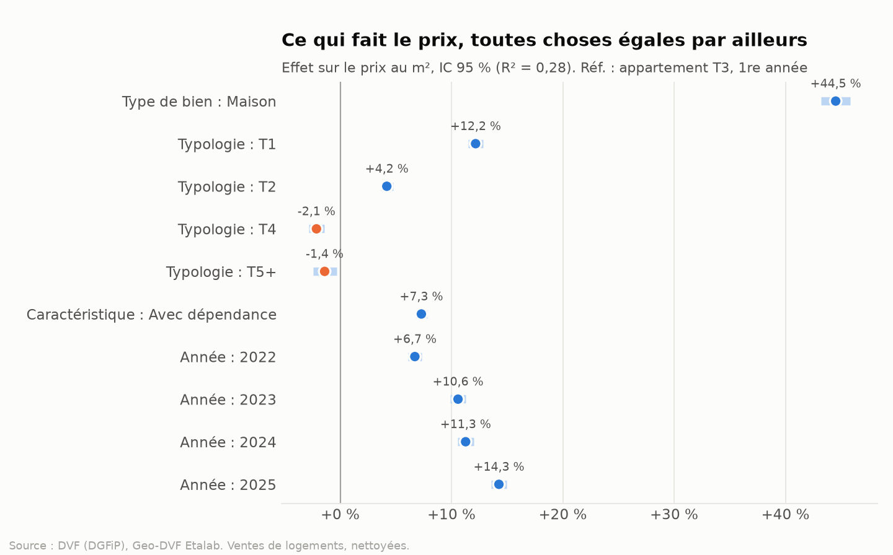 | 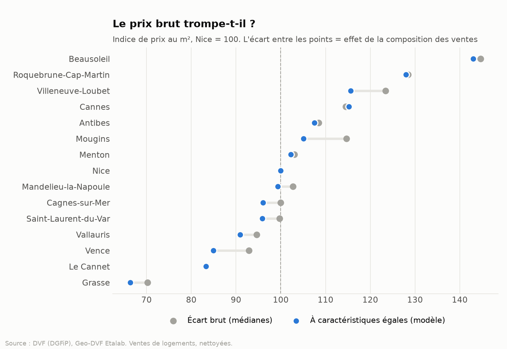 |

Le modèle est validé par un test : sur des données synthétiques où les effets sont connus à l'avance, il doit les retrouver à ±2,5 points.

## Note de synthèse

Chaque exécution produit une [note de synthèse de 2 pages](outputs/note_de_synthese.pdf) pour un lecteur non technique : chiffres clés, enseignements, graphiques. Générée à partir des mêmes tables que le reste, elle ne peut pas se désynchroniser des données.

## Architecture

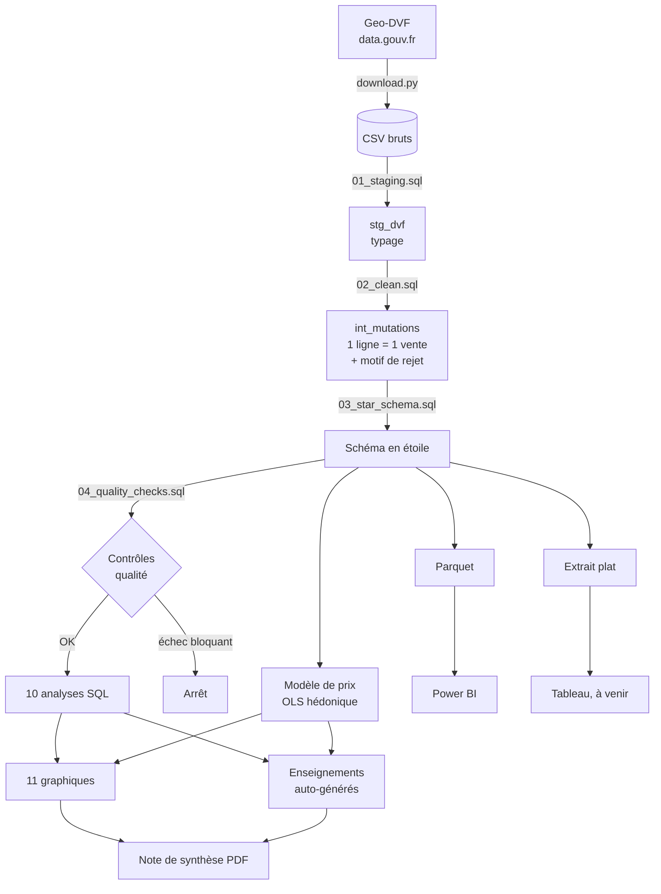

## Modèle de données

```mermaid
erDiagram
    fact_ventes }o--|| dim_date : date_key
    fact_ventes }o--|| dim_commune : code_commune
    fact_ventes }o--|| dim_type_bien : type_bien_key
    fact_ventes {
        string id_mutation PK
        int date_key FK
        string code_commune FK
        int type_bien_key FK
        float valeur_fonciere
        float surface_bati
        string typologie
        float prix_m2
    }
    dim_commune {
        string code_commune PK
        string nom_commune
        bool est_littorale
        float latitude
        float longitude
    }
    dim_date {
        int date_key PK
        date date
        int annee
        string annee_mois
        string saison
    }
    dim_type_bien {
        int type_bien_key PK
        string type_local
    }
```

## Les pièges des données DVF, et comment je les ai traités

Les données DVF sont publiques mais **trompeuses si on les lit naïvement**. Ce projet en traite trois :

**1. Une ligne n'est pas une vente.** Une maison avec jardin apparaît sur trois lignes (une par nature de terrain), avec la surface et le prix répétés. Un `COUNT(*)` donne trois maisons ; un `SUM(valeur_fonciere)` triple le prix. Le pipeline dédoublonne les logements avant de compter, et prend le prix une seule fois par vente.

**2. Les ventes groupées faussent le prix au m².** Un immeuble de 5 appartements vendu en un seul acte affiche un prix global. Divisé par la surface d'un seul lot, il produit un prix au m² absurde. Ces ventes sont isolées et exclues.

**3. L'année en cours est incomplète.** Geo-DVF publie avec environ 6 mois de retard. Comparer l'année en cours à une année pleine affiche une fausse chute de 50 % des ventes. Les analyses se calent sur la dernière année complète.

Chaque vente exclue reçoit un **motif explicite**, et un contrôle bloquant vérifie qu'aucune vente ne disparaît en silence :

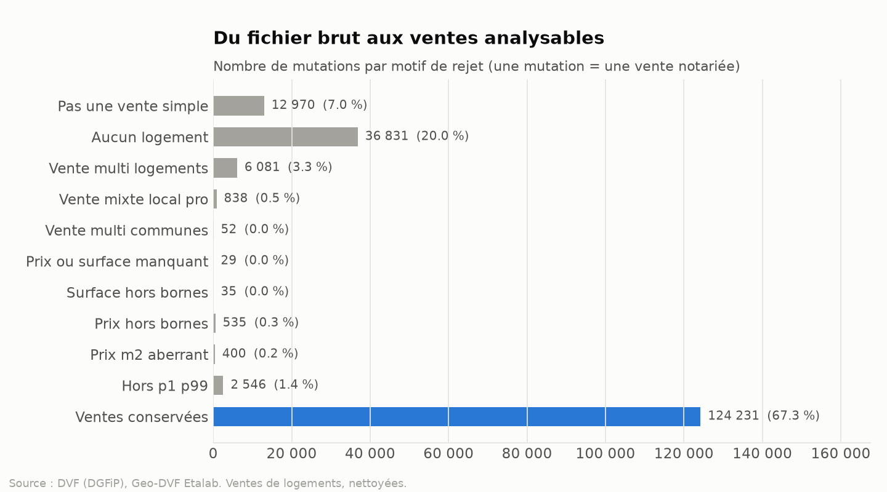

## Qualité et tests

- **11 contrôles qualité automatiques** sur le modèle (unicité, intégrité référentielle, réconciliation brut/conservé/rejeté, continuité du calendrier, bornes métier). Un échec bloquant arrête le pipeline avant toute publication. Rapport : `outputs/quality_report.md`.
- **26 tests** (`pytest`) : un jeu de données construit à la main où chaque vente reproduit un piège réel, la validation du modèle sur des effets connus, et le pipeline de bout en bout.
- **Intégration continue** GitHub Actions : lint, tests et pipeline complet sur données synthétiques à chaque commit.
- **Actualisation automatique** : chaque mois, une GitHub Action retélécharge DVF, relance tout et publie le README, les graphiques et la note mis à jour. Si un contrôle bloquant échoue, rien n'est publié.

## Lancer le projet

```bash
git clone https://github.com/AtikaWamra/dvf-cote-azur.git
cd dvf-cote-azur
python -m venv .venv && source .venv/bin/activate   # Windows : .venv\Scripts\activate
make install
make all        # téléchargement + pipeline complet (environ 1 minute)
```

Sans `make` (Windows) : `pip install -e ".[dev]"` puis `python -m dvf.cli all`.

Sans connexion : `make demo` exécute tout le pipeline sur des données synthétiques au format DVF.

Pour ajouter le Var : `DEPARTEMENTS = ["06", "83"]` dans `src/dvf/config.py`.

## Structure

```
dvf-cote-azur/
├── sql/
│   ├── 01_staging.sql          typage des fichiers bruts
│   ├── 02_clean.sql            grain vente + motifs de rejet + audit
│   ├── 03_star_schema.sql      modèle en étoile
│   ├── 04_quality_checks.sql   contrôles qualité
│   ├── analysis/               10 requêtes d'analyse
│   └── 05_bi_extracts.sql      extrait plat pour Tableau
├── src/dvf/                    pipeline, modèle, graphiques, enseignements, note PDF
├── tests/                      pièges DVF, validation du modèle, bout en bout
├── powerbi/                    tableau de bord .pbix, mesures DAX, thème
├── tableau/                    préparation d'une Story Tableau Public (à venir)
├── .github/workflows/          CI + actualisation mensuelle
├── seeds/                      référentiels (communes littorales)
├── docs/                       méthodologie, dictionnaire de données
└── images/                     graphiques générés
```

## Stack

**SQL** (DuckDB : CTE, fonctions de fenêtre, `QUANTILE_CONT`, `FILTER`) · **Python** (pandas, statsmodels, matplotlib, reportlab) · **Power BI** (DAX, What-if, info-bulles) · **pytest** · **GitHub Actions**

## Source et licence

Données : [Demandes de valeurs foncières géolocalisées](https://www.data.gouv.fr/fr/datasets/demandes-de-valeurs-foncieres-geolocalisees/), DGFiP / Etalab, Licence Ouverte 2.0. Code : MIT.

---

**Atika Wamra** · Data Analyst · [LinkedIn](https://linkedin.com/in/wamra-atika) · [GitHub](https://github.com/AtikaWamra)
